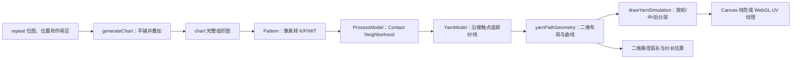
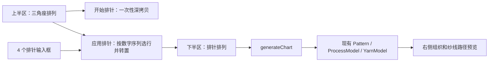

# KnitScape 当前功能与算法说明

更新时间：2026-08-19
核对分支：`codex/one-shot-uniform-yarn-length`
核对提交：`7e62123`（`refactor: separate left sidebar responsibilities`）
文档性质：第 1–10 节记录当前源码事实；第 11 节记录已确认、尚未实现的下一版本规格

## 1. 项目当前定位

KnitScape 当前是一套面向单面纬编组织编辑、配色和样品外观预览的离线网页应用。它可以编辑针法组织图、重复单元、逐行用纱、双纱参数和扫描纱线纹理，并在右侧生成分层纱线路径预览。

当前右侧预览属于 **2D/2.5D 纱线路径可视化**：纱线仍绘制在 `back / mid / front` 三层 Canvas 上，用图层顺序表达局部前后关系。它不是可自由旋转的真实 3D 线圈模型，也没有材料力学、碰撞或防穿模求解。

## 2. 当前已实现功能

| 模块 | 已实现内容 | 当前边界 |
|---|---|---|
| 单面布工作区 | 项目只保留单面布应用；主界面包含左侧参数、中间组织编辑、右侧预览 | 不包含双面布或设备控制模块 |
| 针法编辑 | 4 个针法按钮；界面名称为“成圈（下）/成圈（上）/平针/半针”，内部编码为 `knit / purl / slip / tuck` | 图标表示针法操作，不是横向针数或纵向行数 |
| 持续画笔 | 点击针法后自动启用画笔，可连续点击或拖动多个格子；画笔按钮可暂停，退出可结束编辑 | 修改的是 repeat 位图，再由 repeat 生成整张 chart |
| 画布尺寸 | 横向针数和纵向行数独立设置，界面范围 `5–500`；尺寸变化同步 chart 和主 repeat 作用区 | 它们只表示组织图大小，不表示针法 |
| Repeat 编辑 | repeat 最小单元宽高独立调整；支持作用区、位置、多个花型叠加和内置图库 | 主 repeat 与附加 repeat 按顺序覆盖，不是物理织造顺序 |
| 组织图显示 | 符号层、色纱层、网格层和 repeat 边界分层绘制；支持缩放、平移和适配 | 组织图是离散格点数据 |
| 色纱与行序列 | 可添加、编辑、删除、打乱色纱；逐行指定用纱；色纱序列始终与 chart 行数对齐 | 行序列按颜色索引工作，不是喂纱器工艺参数 |
| 双纱参数 | 第一、第二支纱线可设置颜色和直径；第二支可开关；第二支复用第一支的中心路径 | 当前“双纱”是共享路径的视觉叠加，不模拟捻合或纱间碰撞 |
| 线圈松紧外观 | 第一支纱线提供 `0.90–1.10` 的 `lengthScaleY` 调节；第二支跟随第一支形状 | 实际作用是线圈高度/松紧视觉系数，不是等比例实际纱长输入 |
| 扫描纱线纹理 | 每支纱线可导入、启用、清除纹理；支持去背景、纹理强度、毛羽强度和 256/512/1024 处理尺寸 | 纹理效果用于外观近似，不是材料扫描或物性反演 |
| PBR 图片字段 | 可导入 Base Color、Normal、Roughness、Height、AO 图片，并保存到项目 JSON | 当前 WebGL 着色是 2D ribbon 视觉近似，不是完整 3D PBR 材质系统 |
| 预览性能 | `自动 / 质量 / 纯色` 三档；自动模式在连续交互时降级为纯色，停止约 180 ms 后恢复纹理 | 质量模式仍受浏览器 WebGL 和贴图尺寸限制 |
| 右侧预览交互 | 支持平移、滚轮/按钮/滑块缩放、适配和翻面 | 不支持 3D 旋转 |
| 纱长读数 | 输入机号 G，显示针距和 `cm / 100线圈` 的二维几何估算值 | 未经实物标定，不可直接作为工厂送纱、成本核算或质量判定依据 |
| 文件操作 | 新建、JSON 导入、JSON 导出、SilverKnit TXT、Kniterate TXT、Punchcard SVG 和 Punchcard 预览 | PNG、Simulation SVG、BMP 函数仍在源码中，但对应按钮已注释，不属于当前可见交付功能 |
| 图库 | 加载 `examples/*.json` 中的内置图案 | 没有云端图库 |
| 撤销 | 对 repeats、色纱、行序列和双纱参数生成时间间隔快照并撤销 | 快照间隔为 1 秒；不是逐个键鼠事件的完整历史 |
| 设置与调试 | 反转滚轮、网格开关、调试面板、符号线宽、全屏 | 调试面板面向开发检查 |
| 多语言 | 简体中文、繁体中文、英语、越南语；语言选择保存到浏览器 | 业务数据本身不做语言转换 |
| 离线与内网 | Vite 静态构建；含 Windows x64 离线 Node 环境、安装/运行/打包/验证脚本 | 没有账号、服务器或云同步 |
| 代码指南 | 通过 URL 模式打开内置代码定位覆盖层，帮助把界面元素映射到源码 | 只用于开发说明 |

## 3. 实际运行架构



主要源码职责：

| 路径 | 职责 |
|---|---|
| `src/state.js` | 全局状态、状态派发、快照和撤销 |
| `src/components/generateChart.js` | 由多个 repeat 生成完整 chart |
| `src/simulation/Pattern.js` | 针法像素到内部操作编码 |
| `src/simulation/ProcessModel.js` | 建立接触邻域和接触点状态 |
| `src/simulation/YarnModel.js` | 追踪纱线路径并判定绘制层级 |
| `src/simulation/yarnPathGeometry.js` | 节点布局、曲线生成、松紧形变和纱长统计 |
| `src/simulation/drawYarnSimulation.js` | 组织绘制命令并分层渲染 |
| `src/simulation/yarnPathSampler.js` | 采样 SVG 路径，计算长度、切线和法线 |
| `src/simulation/yarnPathUvStrip.js` | 把中心线扩展为带 UV 的 ribbon 网格 |
| `src/simulation/yarnUvWebglRenderer.js` | WebGL 纹理渲染和贴图缓存 |

## 4. 核心数据结构

### 4.1 组织与 repeat

```text
chart: Bimp(width, height, pixels)
repeats: [
  {
    bitmap: Bimp(repeatWidth, repeatHeight, stitchIndexes),
    pos: [x, y],
    area: [width, height]
  }
]
```

`chart` 是最终组织图；`repeats` 是可编辑的最小单元和覆盖规则。针法像素索引固定为：

| 像素索引 | 内部名称 | ProcessModel 操作 |
|---:|---|---|
| 0 | `knit` | `K` |
| 1 | `purl` | `P` |
| 2 | `slip` | `M`（miss） |
| 3 | `tuck` | `T` |

默认针法是 `purl`，默认完整 chart 为 `48 × 60`，默认 repeat 为 `4 × 8`。

### 4.2 色纱与双纱

```text
yarnPalette: [cssColor, ...]
yarnSequence: Bimp(1, chartHeight, yarnIndexes)
yarnPlies: [
  {
    name,
    color,
    diameter,
    lengthScaleY,
    enabled,
    texture
  }
]
```

`yarnSequence` 的宽度固定为 1，每一行存一个色纱索引。改变 chart 高度时，已有行被保留，新行使用当前活动色纱补齐。

默认第一支纱线直径系数为 `0.24`、启用；第二支为 `0.14`、默认关闭。直径是相对于当前 `stitchWidth` 的视觉比例，不是毫米。

### 4.3 视图状态

`simScale / simPan` 控制右侧预览；`flipped` 交换 front/back 显示顺序；`texturePerformanceMode` 决定纯色或纹理路径；`machineGauge` 用于单位换算；`yarnLengthMetrics` 保存当前估算结果。

## 5. 已实现算法

### 5.1 Repeat 平铺与覆盖算法

1. 创建与当前 chart 同尺寸、填充默认针法的空位图。
2. 对每个 repeat 的 bitmap 做纵向坐标转换。
3. 使用 `Bimp.fromTile()` 把最小单元重复铺满该 repeat 的 `area`。
4. 按 repeat 数组顺序，在 `pos` 位置覆盖到 chart。
5. repeat 更新时重新生成 chart；组织预览随后重新计算。

选择 chart 单元时会反向遍历 repeats，因此优先命中视觉上更上层的 repeat，再用取模把 chart 坐标映射回 repeat 单元坐标。

### 5.2 持续针法画笔算法

选择针法只更新两个状态：

```text
activeSymbol = 选中的针法索引
activeTool = "brush"
```

画笔从起点到当前指针位置调用位图直线写入算法，因此单击可改一个格子，拖动可连续改多个格子。切换针法不会立即覆盖上一次选中的格子，避免误修改。

### 5.3 Contact Neighborhood 拓扑算法

`ProcessModel` 为宽 `m`、高 `n` 的组织建立 `2m × (n+1)` 接触邻域。每个接触点保存：

```text
[stitchType, actualizationValue, movementVector]
```

接触状态包括：

- `ECN`：空接触点；
- `PCN`：潜在接触点；
- `ACN`：已经实际化的接触点；
- `UACN`：暂未锚定的实际接触点。

每行按左右交替的蛇形方向处理。`K/P` 会实际化下方接触点并建立上方潜在接触点；`T/M` 会保留、抬升或移动已有接触关系。这个模型负责确定“纱线经过哪些接触点”，并不计算三维受力。

### 5.4 沿纱追踪算法

`YarnModel.followTheYarn()` 在 Contact Neighborhood 中按行蛇形移动，区分 leg/head 节点，并沿 movement vector 递归寻找节点最终位置。

相邻路径点被转换成 link，link 保存行号、链接类型和绘制层。层级规则是：

- 两端都是 `K`：特定腿/头链接放 `front`，其余放 `back`；
- 两端都是 `P`：前后规则反转；
- 混合关系：放入 `mid`。

这是一套二维绘制层级规则，用于表达视觉穿插，不等同于三维 Z 坐标或碰撞接触。

### 5.5 二维节点布局与曲线算法

预览先根据容器和组织尺寸求 `stitchWidth`，再使用固定宽高比：

```text
STITCH_RATIO = 5 / 3
baseStitchHeight = stitchWidth / STITCH_RATIO
stitchHeight = baseStitchHeight × lengthScaleY
yarnWidth = stitchWidth × yarnDiameter
```

接触点落在二维规则网格上。每个节点根据相邻点得到法线，纱线中心点沿法线偏移半个 yarnWidth。最终路径由 D3 `curveCatmullRomOpen` 生成 SVG 三次贝塞尔曲线。

为保持边缘连续，真实组织左右各补 1 个辅助针位；辅助针位参与路径生成，但不参与纱长统计。

### 5.6 松紧形变与连续性保护

`lengthScaleY` 被限制在 `0.90–1.10`。它直接改变行高，并对非边界 neck 点做较小的 X 向补偿：

```text
xCompensation = 1 + (lengthScaleY - 1) × 0.2
```

只有整行全部为 `K/P` 时才应用该系数；包含 `M/T` 的行回到基准系数。路径生成后，算法检查同一行相邻 path 的首尾误差；容差为 `stitchWidth × 1e-6`。如果不连续，该行回退到基准形状。

源码中存在 `solveSharedCoefficient()` 搜索函数，但当前运行路径没有调用它。也就是说，当前并没有以目标纱长为约束反求几何系数。

### 5.7 纱长几何估算算法

每条最终 SVG 三次贝塞尔曲线固定采样 24 段，以二维折线长度近似弧长。统计只包含左右辅助针位之间的有效区域。

```text
needlePitchMm = 25.4 / machineGauge
averageLoopLengthStitchUnits = total2DPathLength / effectiveLoopCount
cmPer100Loops = averageLoopLengthStitchUnits × needlePitchMm × 100 / 10
effectiveLoopCount = chart.width × chart.height
```

机号输入范围为 `1–120 G`，默认 `G32`。

必须注意：

- 该长度来自二维中心线投影，不包含真实 Z 向路径；
- 一个 `stitchWidth` 被直接假设为一个针距；
- `lengthScaleY` 增减 10% 不会让最终估算纱长等比例增减 10%；
- `effectiveLoopCount` 仍把每个格子都计为一个 loop，混合 `slip/tuck` 时计数口径不严谨；
- 未包含纱线弹性、摩擦、张力、rob-back、牵拉、松弛、染整收缩或机器成圈区几何。

因此界面当前显示的“当前纱长”应理解为 **二维几何估算值**。

### 5.8 路径 UV ribbon 算法

纹理模式不再把图片固定铺在屏幕坐标，而是沿纱线路径展开：

1. 解析 SVG 的 `M/L/Q/C/Z` 命令。
2. 把曲线离散为中心线点。
3. 按累计弧长重新等距采样，得到每个点的切线和二维法线。
4. 沿法线向左右各偏移半个 `yarnWidth`，形成带状网格。
5. `u = 累计路径长度 / 纹理重复长度`，`v = 0/1` 表示纱线两侧。
6. 相邻两组左右顶点组成两个三角形，由 WebGL 绘制。

当前常量：采样间距 `3` 像素、纹理重复长度 `48`、每段路径最多 `1200` 个采样点。

### 5.9 纹理渲染与降级算法

WebGL 渲染器读取 Base Color、Normal、Roughness、Height 和 AO map，并结合颜色、纹理强度和毛羽强度生成 ribbon 外观。渲染结果再合成回原有的三层 Canvas。

当 WebGL 不可用、纹理未启用或性能模式为纯色时，系统回退到 Canvas 2D 线条/纹理画笔。纹理缓存有数量上限；淘汰时释放 WebGL texture，避免无限占用显存。

### 5.10 事件驱动渲染与性能控制

全局状态变化通过 `StateMonitor` 通知各组件。Lit 页面更新由 `requestAnimationFrame` 合并，同一帧内多次状态变化只排队一次。纱线模拟对相关状态变化使用约 150 ms 防抖；滚轮缩放先更新预览 transform，减少连续重算。

自动纹理模式在交互开始时临时关闭纹理，交互停止约 180 ms 后恢复。这样优先保证拖动和缩放响应。

### 5.11 状态快照与撤销算法

当 `yarnPalette / yarnSequence / yarnPlies / repeats` 发生变化，且距离上次快照超过 1 秒时，系统保存这些字段的前一状态。撤销取出最新快照并同步所有组件。选择、平移、缩放等临时视图状态不会进入该快照。

## 6. 文件导入导出格式

当前 JSON 导出字段：

```json
{
  "width": 48,
  "height": 60,
  "repeats": [
    {
      "bitmap": {},
      "pos": [0, 0],
      "area": [48, 60]
    }
  ],
  "yarnPalette": [],
  "yarnSequence": {},
  "yarnPlies": []
}
```

导入时会恢复尺寸、repeat、色纱序列、双纱和纹理字段；旧文件缺少双纱字段时使用默认值兼容。当前导入入口直接解析本地 JSON，没有完整的 schema 校验和错误恢复界面。

## 7. 技术栈与开发方式

| 项目 | 当前使用 |
|---|---|
| 编辑器 | Visual Studio Code |
| 运行环境 | Node.js / 浏览器 |
| 开发与构建 | Vite 4.4.7 |
| UI 模板 | lit-html 2.7.5 |
| 曲线与几何 | D3 7.8.5 |
| 页面分栏 | Split.js |
| 图标 | Font Awesome + 项目原始 4 个针法 SVG |
| 预览 | Canvas 2D + WebGL 1 ribbon |

常用命令：

```powershell
npm run dev
npm run build
```

也可以直接运行根目录 `一键启动.bat`，或使用 `安装环境` 中的离线脚本。

## 8. 当前验证结果

2026-08-14 在上述分支和提交上完成验证：

- `20 / 20` 个 `validate:*` 自动验证通过；
- `npm run build` 通过；
- Vite 转换 `672` 个模块；
- 生产入口 JS 为约 `224.72 kB`，gzip 后约 `70.44 kB`；
- 构建产物输出到 `dist/`。

自动验证覆盖：单面应用约束、代码指南、内网构建、单面 UI、多语言、chart/repeat 尺寸分离、双纱、滚轮性能、已移除的旧纱长模拟、行长模型、机号读数、纱长参数链、逐行色纱、中央针法栏、路径 UV、事件驱动渲染、纹理缓存生命周期、模拟结果特征、模拟模块拆分和左侧栏模块拆分。

## 9. 当前明确未实现

以下内容不应被描述为当前功能：

- 左右相邻的相同针法一键合并；
- 两个组织图图标合并成一个宽线圈；
- 两个原图标保持存在并显示相同分组颜色；
- 可旋转的 Three.js 真实 3D 线圈；
- 纱线管状几何、Z 向上下关系和局部碰撞检测；
- 防穿模、接触、摩擦、弯曲、扭转、张力或松弛物理求解；
- 大圆机或其他织造设备联机、控制和工艺参数下发；
- 依据样布实测标定的生产级耗纱预测；
- 账号、云保存、在线协作和服务器图片上传。

仓库中曾有“左右相同针法合并与局部 3D”的计划文档，但当前分支没有对应按钮、状态、几何模块、碰撞模块或 Three.js 依赖，所以它仍不属于当前交付版本。

## 10. 理论与使用边界

当前算法与针织建模的基础思想一致之处，是使用纱线中心路径、接触拓扑和每针平均长度表达组织；但它没有达到生产预测或数字孪生所需的三维物理层级。

保留下来的关键参考方向：

- EN 14970:2006：线圈长度应按织入一个针目的纱线长度进行实测，并区分喂纱器或花型横列；
- Leaf & Glaskin（1955）：普通针织线圈需要完整几何描述；
- Munden（1959）：线圈长度和松弛状态共同影响普通针织物尺寸；
- Kaldor、James、Marschner（2008）：高保真 yarn-level 模型需要三维纱线、近似不可伸长约束和接触处理。

参考链接：

- <https://www.evs.ee/en/evs-en-14970-2006>
- <https://www.tandfonline.com/doi/abs/10.1080/19447027.1955.10750345>
- <https://www.tandfonline.com/doi/abs/10.1080/19447025908659923>
- <https://dl.acm.org/doi/10.1145/1360612.1360664>

适用结论：当前版本适合组织编辑、配色、路径结构展示和外观趋势比较；未经实际样布标定前，不适合直接输出工厂送纱值、用纱成本、质量判定或论文级物理预测。

## 11. 下一版本已确认规格：三角座与排针分离

> 状态：**需求已确认，代码尚未开始修改。** 继续开发时应以本节为准；在完成实现和验证以前，不得把本节内容写入“当前已实现功能”。

### 11.1 目标和业务边界

下一版本先服务于 **单面针织组织**，不增加双面针床，也不连接或控制大圆机。

当前中间编辑区的业务含义需要修正：

- 现有的组织排列保留，但定义为 **三角座排列**；
- 新增一套独立的 **排针排列**；
- 三角座排列只用于查看和编辑工艺来源，不再直接驱动右侧组织/面料预览；
- 排针排列是右侧组织图和纱线路径预览的唯一针法数据来源；
- 右侧仍复用当前模拟管线，本阶段不新建第二套 3D 或渲染引擎。

目标数据流：



三角座与排针在完成初始化后必须保持独立：修改上半区不得自动改变下半区或右侧预览；修改下半区应立即更新右侧预览。

### 11.2 中间编辑区布局

中间区域改为 **上下分屏**：

1. 上半区显示“三角座排列”；
2. 下半区显示“排针排列”；
3. 两区之间使用可拖动的水平分隔条，方便按需要调整高度；
4. 顶部只保留一套共用的四个针法按钮；
5. 选择针法后直接进入持续绘制状态，在鼠标当前所在的上区或下区修改对应数据；
6. 上下两区的“画笔”按钮和“退出”按钮全部删除，同时清理关联事件、状态、样式和翻译，不留下不可达的旧逻辑；
7. 上下两区都保留各自的宽度和高度输入框；既能键盘输入，也能使用数字输入框内部的上下箭头调整。

宽高行为：

- 上区宽高只改变三角座排列；
- 下区宽高只改变排针排列；
- “应用排针”会根据转换结果自动覆盖下区宽高；
- 应用以后，用户仍可手动修改下区宽高和格子；
- 再次点击“应用排针”时，允许覆盖下区此前的手动尺寸和手动画法。

### 11.3 开始排针与应用排针

两个动作的职责应区分：

- **开始排针**：首次建立排针数据时，把当时的三角座排列进行深拷贝，作为下区初始内容；后续上下区不再实时同步。
- **应用排针**：读取四个输入框，把输入内容从左到右拼接成完整排针循环，再依据三角座排列重新生成整个下区。

“应用排针”采用显式提交，不在输入过程中实时重建：

1. 用户编辑四个输入框时，只更新输入草稿；
2. 点击“应用排针”后统一校验；
3. 校验成功才一次性替换下区内容和尺寸；
4. 校验失败时标出有问题的输入框，原有排针排列和右侧预览保持不变，避免半更新状态。

### 11.4 四个输入框与完整排针循环

每个输入框使用数字 `1–4` 表示选择三角座排列的第 1–4 行，并允许连续输入常见循环，例如：

```text
1
11
123
1234
1212
```

四个输入框按照界面从左到右直接拼接，不插入分隔符。例如：

```text
输入框 1 = 1
输入框 2 = 11
输入框 3 = 123
输入框 4 = 1234

完整排针循环 = 1111231234
```

第一版本的校验边界：

- 只接受字符 `1`、`2`、`3`、`4`；
- 每个数字必须能对应当前三角座排列中存在的行；
- 非法字符、空值或越界行号不得修改现有排针结果；
- 输入框保留用户原始文本，错误信息应定位到具体输入框。

### 11.5 排针转换算法

图片示例已经确认不是旋转或镜像，而是 **按序列选取三角座的行，然后转置为排针列**。

定义：

```text
C[r][x]：三角座矩阵中第 r 行、第 x 列的针法
S[n]：完整排针循环中第 n 个数字所选择的三角座行号
P[x][n]：生成后的排针矩阵中第 x 行、第 n 列的针法
```

转换公式：

```text
P[x][n] = C[S[n] - 1][x]
```

因此：

```text
排针宽度 = 完整排针循环长度
排针高度 = 原三角座宽度
```

用户图片中的已确认示例：三角座为 `8 × 4`，排针序列为 `1234`，转换后排针为 `4 × 8`。

```text
转换前 C（8 列 × 4 行）
第1行：K K K K K K M M
第2行：K K K K M M K K
第3行：K K M M K K K K
第4行：M M K K K K K K

应用 1234 后 P（4 列 × 8 行）
第1行：K K K M
第2行：K K K M
第3行：K K M K
第4行：K K M K
第5行：K M K K
第6行：K M K K
第7行：M K K K
第8行：M K K K
```

序列中的重复数字表示重复选取对应行。例如 `11` 会连续生成两列相同的第 1 行结果，`1212` 会按第 1、2、1、2 行交替生成四列。

转换算法必须写成不依赖界面的纯函数，输入三角座位图和数字序列，输出新的排针位图；这样既方便测试，也避免在组件中复制矩阵逻辑。

### 11.6 状态、编辑和预览职责

运行时必须保存两份互相独立的数据：

```text
三角座排列：上半区编辑数据
排针排列：下半区编辑数据，也是右侧预览数据源
排针输入草稿：四个尚未应用的字符串
```

具体行为：

- 共用的是针法选择状态，不是上下两区的位图对象；
- 开始排针必须深拷贝，不允许上下区共享同一个 bitmap 引用；
- 下区手动画格后立即重新生成右侧 chart；
- 上区手动画格只改变三角座显示；
- 撤销快照需要纳入三角座、排针和已应用排针状态，避免只撤回其中一半；
- 右侧色纱、双纱、纹理、PBR 图片字段、缩放和性能模式继续沿用现有实现。

### 11.7 JSON 保存与旧项目兼容

新 JSON 需要分别保存三角座排列、排针排列以及四个排针输入值，不能只保存转换后的 chart。

旧项目文件没有排针字段时采用一次性兼容迁移：

1. 把旧 repeat 数据解释为三角座排列；
2. 深拷贝一份作为初始排针排列，保证打开旧项目时右侧预览不会突然为空；
3. 只在导入边界做兼容，运行时统一使用新数据结构；
4. 再次导出时写入新格式，不长期保留两套预览分支。

导入过程应对新字段做基本结构校验；迁移失败时不能破坏当前已打开项目。

### 11.8 代码精简与可维护性约束

实现时不得直接复制一整套现有编辑器源码。计划采用一个可复用的编辑器组件，由参数决定标题、位图、尺寸和更新回调，上下两区复用同一份绘制、缩放、点击和拖动逻辑。

建议把业务逻辑收敛为少量独立函数：

```text
concatNeedleInputs(inputs)            拼接四个输入框
validateNeedleSequence(sequence, rows) 校验字符和可用行号
buildNeedleBitmap(camBitmap, sequence) 按选行转置公式生成排针位图
```

实施约束：

- 不建立第二套预览引擎；
- 不在组件模板里实现矩阵转换；
- 不保留旧版和新版两套运行路径；
- 不用注释掉的代码代替版本管理；
- 删除不再使用的按钮、处理器、状态、样式、翻译和测试；
- 兼容逻辑只放在 JSON 导入边界；
- 数据命名应明确区分 `cam`（三角座）与 `needle`（排针），避免继续把两者统称为组织图。

### 11.9 版本保护与回退方案

回退使用 Git 完成，不在应用界面中增加“旧版/新版”切换按钮，以免长期维护两套代码。

开始功能代码前必须完成：

1. 核对并整理当前未提交改动，不能误覆盖用户已有文件；
2. 建立一个可识别的功能前基线提交；
3. 为该基线建立备份标签或备份分支，例如 `backup/pre-needle-arrangement-2026-08-19`；
4. 在独立功能分支中开发，例如 `feature/needle-arrangement`；
5. 以可独立验证的小提交推进，不把所有改动压进一次提交。

建议提交阶段：

1. 功能前基线和现状验证；
2. 排针拼接、校验和矩阵转换纯函数及测试；
3. 共用编辑器抽取与上下分屏；
4. 排针状态、手动编辑和右侧预览数据源切换；
5. JSON 迁移、撤销、翻译和死代码清理；
6. 完整验证与文档更新。

如果结果不符合要求，应通过切换回基线分支或标签恢复，不使用破坏性的 `git reset --hard`，也不删除功能分支；这样既能立即回到旧版本，也能保留新版本供后续比较和修改。

当前 `7e62123` 是最近一次已提交版本，但工作区仍包含文档清理和验证脚本改动，所以在真正开始功能代码前还需要重新核对并建立新的干净基线。本节只记录方案，**尚未声称备份分支或标签已经创建**。

### 11.10 第一版本验收清单

实现完成后至少验证以下场景：

- 中间区为上方三角座、下方排针，分隔条可拖动；
- 四个针法按钮只保留一套，并能分别在上下区持续绘制；
- 两边都没有画笔和退出按钮，也没有遗留无用逻辑；
- 两边宽高都支持键盘输入和内部上下箭头；
- “开始排针”深拷贝当前三角座，之后上下编辑互不影响；
- 四框 `1 | 11 | 123 | 1234` 拼接为 `1111231234`；
- 图片基准 `8 × 4 + 1234` 精确生成 `4 × 8` 结果；
- 非法输入不会改变下区或右侧预览；
- 修改上区不改变右侧预览，修改下区立即改变右侧预览；
- 应用后可以手动改下区格子和尺寸；再次应用会完整覆盖这些手动修改；
- 旧 JSON 可以打开并得到初始排针，新 JSON 可以往返导入导出；
- 撤销不会造成三角座、排针和预览彼此错位；
- 原有色纱、双纱、纹理、PBR 字段、缩放和构建验证不回归；
- 代码中不存在上下两套重复编辑器或新旧两套预览管线。

## 12. 文档维护规则

本文件是项目唯一的功能与算法总说明。后续代码发生实际变化时，直接更新本文件：

1. 只把已进入当前可运行分支并经过验证的内容写入“已实现”；
2. 计划、设想和实验原型必须放在“未实现”或“边界”中；
3. 算法描述以运行时调用链为准，不能只依据未被调用的辅助函数；
4. 每次更新记录分支、提交、验证数量和构建结果；
5. 避免再次拆出重复的进度、计划、规格和审计 Markdown；下一版本的确认和实施状态继续更新第 11 节；
6. 第 11 节的功能完成并验证后，再把相应条目迁移到“已实现功能”和“已实现算法”，同时删除已经失效的计划措辞。
