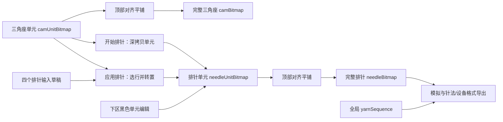

# KnitScape 当前功能与算法说明

本文说明当前实际运行的功能、数据流和算法边界。

## 1. 项目定位

KnitScape 是一套面向单面纬编组织编辑、配色和样品外观预览的离线网页应用。中间工作区分为：

- **三角座排列**：编辑三角座循环单元；
- **排针排列**：编辑实际排针循环单元，并向完整排针画布派生；
- **右侧模拟**：读取完整排针派生结果，显示 2D/2.5D 纱线路径。

右侧预览用 `back / mid / front` 三层 Canvas 表达局部前后关系，不是可自由旋转的真实 3D 线圈，也不包含材料力学、碰撞或防穿模求解。

## 2. 当前已实现功能

### 2.1 默认尺寸和数据所有权

默认状态为：

```text
canvasWidth × canvasHeight = 60 × 60
camUnitBitmap              = 8 × 4
needleUnitBitmap           = 8 × 4
yarnSequence               = 1 × 60
```

`camUnitBitmap` 和 `needleUnitBitmap` 是唯一可直接编辑的针法源数据。`camBitmap` 和 `needleBitmap` 不是第二份业务输入，而是由循环单元按 `canvasWidth × canvasHeight` 顶部对齐平铺得到的完整派生位图：

```text
camUnitBitmap    ──顶部对齐平铺──> camBitmap
needleUnitBitmap ──顶部对齐平铺──> needleBitmap
```

完整画布的横向针数和纵向针数共用一组顶部数字输入，默认 `60 × 60`，允许范围为 `5–500`。输入支持键盘和浏览器原生步进按钮；编辑中的数字保持黑色，提交后再按规范值回填。修改完整画布尺寸不会改变两个循环单元的尺寸。

### 2.2 黑色单元和灰色派生区

两个编辑器都叠加显示两层内容：

- 黑色区域：当前循环单元，可用所选针法绘制；
- 灰色区域：循环单元平铺后的完整画布，只读。

左键绘制只在黑色循环单元命中时开始；点击或拖过灰色派生区不会修改状态。黑色单元变化后，灰色完整画布由同一派生函数重新生成，因此重复位置同步变化。

### 2.3 开始排针和应用排针

“开始排针”深拷贝当前 `camUnitBitmap` 到 `needleUnitBitmap`，不共享像素数组。默认状态下点击后，排针循环单元仍为 `8 × 4`。

四个排针输入框从左到右组成行号序列。每个字符只能是 `1–4`，并且对应行必须存在。验证失败时旧排针单元和完整画布保持不变；验证成功后再一次性替换排针循环单元。

设三角座循环单元为 `C[r][x]`，拼接序列为 `S[n]`，输出排针循环单元为 `P[x][n]`：

```text
P[x][n] = C[S[n] - 1][x]
排针单元宽度 = S.length
排针单元高度 = 三角座单元宽度
```

因此默认 `8 × 4` 三角座单元输入 `1 / 2 / 3 / 4` 后，只有点击“应用排针”才会生成 `4 × 8` 排针单元；完整画布仍保持 `60 × 60`。

纯转换函数位于 `src/needleArrangement/transform.js`：

```text
concatNeedleInputs(inputs)
validateNeedleInputs(inputs, rowCount)
buildNeedleBitmap(camUnitBitmap, sequence)
cloneBitmap(bitmap)
```

### 2.4 共享视口与固定色纱栏

三角座和排针编辑器共用 `scale` 与 `chartPan`：

- 初次打开按 `16 × 16` 格范围计算视角，而不是一次显示完整 `60 × 60`；
- 在任一编辑器滚动鼠标滚轮，两个编辑器同步缩放；
- 在任一编辑器按住鼠标中键拖动，两个编辑器同步平移；
- 缩放围绕指针位置计算，平移和缩放都有边界保护。

两个编辑器左侧各有一条固定色纱 gutter。它们都读取和编辑同一个全局 `yarnSequence`，因此修改任意一条会同步反映到另一条。两条 gutter：

- 位于灰色画布窗口之外，不参与横向平移；
- 只复用 `chartPan.y` 和相同缩放，保证行与网格纵向对齐；
- 不随完整画布宽高或横向拖动进入灰色区域；
- 使用共享的交互生命周期，避免两条 gutter 同时绘制时提前结束全局预览状态。

`yarnSequence` 宽度固定为 1，高度跟随完整画布高度；默认是 60 行。改变纵向行数时保留已有行，新行用当前活动色纱补齐。

## 3. 当前数据流



关键约束：

1. 业务动作只修改画布尺寸或两个循环单元，不直接写 `camBitmap` / `needleBitmap`；
2. 状态加载、普通派发和撤销都会从当前源字段重新得到完整位图；
3. 右侧模拟和 BMP、SilverKnit、Kniterate、打孔卡等导出继续读取完整派生 `needleBitmap`，不是只读取黑色循环单元；
4. JSON 保存源字段，导入边界负责迁移旧结构，运行时不保留旧 repeat 多块编辑分支。

## 4. 核心数据结构

当前源状态、派生状态和视图状态的职责分开：

```text
源状态：canvasWidth, canvasHeight, camUnitBitmap, needleUnitBitmap
输入状态：needleInputs, appliedNeedleInputs, needleInputErrors
配色状态：yarnPalette, yarnSequence, yarnPlies
派生状态：camBitmap, needleBitmap
视图状态：scale, chartPan, simScale, simPan, flipped
```

源状态、排针输入和配色进入快照与撤销。恢复快照后，完整位图仍从恢复后的尺寸和循环单元重新派生，不保存可能过期的独立副本。

## 5. JSON v3 与旧文件迁移

当前 JSON 导出格式为 schema v3，核心字段如下：

```json
{
  "schemaVersion": 3,
  "canvasWidth": 60,
  "canvasHeight": 60,
  "camUnitBitmap": { "width": 8, "height": 4, "pixels": [] },
  "needleUnitBitmap": { "width": 4, "height": 8, "pixels": [] },
  "needleInputs": ["1", "2", "3", "4"],
  "appliedNeedleInputs": ["1", "2", "3", "4"],
  "yarnPalette": [],
  "yarnSequence": {},
  "yarnPlies": []
}
```

`deserializePattern()` 对版本、画布尺寸、位图尺寸、像素数量和四段输入做结构校验，并支持：

- **v3**：直接读取完整画布尺寸和两个循环单元；
- **v2**：把旧 `camBitmap` / `needleBitmap` 作为迁移后的两个单元，完整画布使用 `60 × 60`；
- **legacy repeat**：取 `repeats[0].bitmap` 作为三角座单元，深拷贝为排针单元，并保留旧 `width / height` 作为完整画布尺寸。

迁移结果统一进入 v3 源字段，再由同一顶部对齐平铺函数产生完整位图。重新导出只写 schema v3。

## 6. 已实现算法

`Pattern` 把完整排针像素转换为 `K / P / M / T`。`ProcessModel` 建立 Contact Neighborhood，`YarnModel.followTheYarn()` 沿接触关系生成纱线路径，并按 `front / mid / back` 分层绘制。

纱长仍是二维路径估算：

```text
needlePitchMm = 25.4 / machineGauge
averageLoopLength = total2DPathLength / effectiveLoopCount
cmPer100Loops = averageLoopLength × needlePitchMm × 100 / 10
effectiveLoopCount = needleBitmap.width × needleBitmap.height
```

该结果不包含真实 Z 向路径、弹性、摩擦、张力、rob-back、牵拉、松弛或染整收缩，不能直接作为生产送纱或成本依据。

扫描纱线纹理支持 Base Color、Normal、Roughness、Height 和 AO；WebGL ribbon 不可用时回退到 Canvas 2D。状态变化由 `StateMonitor` 通知，根视图更新按帧合并，连续交互时可临时降低纹理负载。

## 7. 主要源码职责

| 路径 | 职责 |
|---|---|
| `src/patternDerivation.js` | 默认尺寸、循环单元到完整画布的顶部对齐平铺 |
| `src/state.js` | 源状态、完整位图派生、快照和撤销 |
| `src/actions/patternEditing.js` | 共用针法、完整画布尺寸、单元绘制、开始和应用排针 |
| `src/needleArrangement/transform.js` | 排针拼接、校验、转置和深拷贝纯函数 |
| `src/patternFile.js` | JSON v3 序列化及 v2 / legacy repeat 迁移 |
| `src/views/chartEditorToolbar.js` | 共用针法与完整画布尺寸输入 |
| `src/views/bitmapEditor.js` | 固定 gutter、裁剪窗口和双层画布 DOM |
| `src/components/drawBitmapEditor.js` | 灰色完整层与黑色可编辑单元层绘制 |
| `src/events/bitmapPointerInteraction.js` | 限制在循环单元内的左键绘制 |
| `src/events/chartPointerPanZoom.js` | 双编辑器共享滚轮缩放和中键平移 |
| `src/components/yarnSequenceCanvas.js` | 两条 gutter 的同源色纱序列绘制 |
| `src/events/colorSequencePointerInteraction.js` | 色纱鼠标交互与全局笔画协调 |
| `src/events/colorSequenceTouchInteraction.js` | 色纱触控交互与触点身份跟踪 |
| `src/components/runSimulation.js` | 以完整派生 `needleBitmap` 启动预览 |
| `src/actions/exporters.js` | 以完整派生 `needleBitmap` 生成导出内容 |

## 8. 技术栈与验证

| 项目 | 当前使用 |
|---|---|
| 开发与构建 | Node.js、Vite 4.4.7 |
| UI | lit-html 2.7.5 |
| 曲线与几何 | D3 7.8.5 |
| 页面分栏 | Split.js |
| 预览 | Canvas 2D + WebGL 1 ribbon |

常用命令：

```powershell
npm run dev
npm run build
```

`package.json` 中的 `validate:*` 脚本覆盖循环单元派生、文件迁移、布局与交互、共享色纱、导出、模拟和原有纹理/纱长回归。

## 9. 当前明确未实现

- 双面针床或双面布组织；
- 可旋转的真实 3D 线圈和纱线管状几何；
- Z 向接触、防穿模、摩擦、弯曲、扭转、张力或松弛物理求解；
- 设备联机、控制和工艺参数下发；
- 未经样布标定即可使用的生产级耗纱预测；
- 账号、云保存、在线协作和服务器图片上传。

## 10. 理论与使用边界

当前算法以完整派生排针、接触拓扑、二维纱线中心路径和每针平均长度表达组织，适合工艺排列编辑、排针生成、配色、路径结构展示和外观趋势比较。未经实际样布标定前，不适合直接输出工厂送纱值、用纱成本、质量判定或论文级物理预测。
