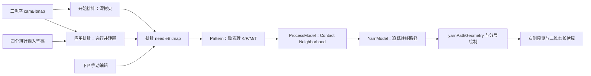

# KnitScape 当前功能与算法说明

更新时间：2026-08-19

核对分支：`feature/needle-arrangement`

核对实现提交：`8f0a04e`（`refactor: remove legacy repeat editor runtime`）

功能前基线：`d3e5a11`

回退标签：`backup/pre-needle-arrangement-2026-08-19`

本文只记录当前分支中已经进入运行路径并经过验证的功能。项目不再维护独立的进度、计划或审计 Markdown。

## 1. 项目定位

KnitScape 是一套面向单面纬编组织编辑、配色和样品外观预览的离线网页应用。当前业务编辑分为两层：

- **三角座排列**：工艺来源，可独立查看和编辑；
- **排针排列**：实际排针结果，是右侧组织图、纱线路径预览和针法导出的唯一针法数据源。

右侧预览属于 2D/2.5D 纱线路径可视化。纱线绘制在 `back / mid / front` 三层 Canvas 上，用图层顺序表达局部前后关系；它不是可自由旋转的真实 3D 线圈模型，也没有材料力学、碰撞或防穿模求解。

## 2. 当前已实现功能

| 模块 | 已实现内容 | 当前边界 |
|---|---|---|
| 单面布工作区 | 左侧参数、中间双编辑器、右侧预览 | 不包含双面针床或设备控制 |
| 三角座与排针 | 中间区上方为三角座，下方为排针；水平分隔条可拖动 | 两份位图互相独立 |
| 共用针法栏 | 仅保留一套 `knit / purl / slip / tuck` 按钮；选择后进入持续绘制 | 上下区不再各自提供画笔或退出按钮 |
| 独立尺寸 | 上下区各有宽、高数字输入；范围 `1–500`；键盘和内部箭头都可用 | 修改一边不会改变另一边 |
| 开始排针 | 对当时的三角座位图做深拷贝并写入排针 | 不是实时同步 |
| 应用排针 | 拼接四个输入框，按数字序列选取三角座行并转置为排针 | 每个输入只接受 `1–4`，且对应行必须存在 |
| 原子校验 | 输入过程只更新草稿；提交失败时定位错误框，旧排针和预览保持不变 | 不自动修正用户输入 |
| 自动适配 | 开始排针、成功应用排针或修改尺寸后重新计算编辑区缩放 | 上下区共用当前编辑缩放值 |
| 排针预览 | 排针手动画格、改尺寸或重新应用后更新右侧预览 | 三角座修改不会触发针法预览变化 |
| 色纱与行序列 | 添加、编辑、删除和打乱色纱；逐行指定色纱；行序列与排针高度对齐 | 色纱序列使用颜色索引，不是喂纱器参数 |
| 双纱参数 | 两支纱线可设置颜色和直径，第二支可开关；第二支复用第一支中心路径 | 不模拟捻合或纱间碰撞 |
| 线圈松紧外观 | 第一支纱线提供 `0.90–1.10` 的 `lengthScaleY` | 是视觉系数，不是实际送纱值 |
| 扫描纱线纹理 | 导入、启用、清除纹理；去背景、纹理/毛羽强度和处理尺寸 | 用于外观近似，不是物性反演 |
| PBR 图片字段 | Base Color、Normal、Roughness、Height、AO 可保存到 JSON | 当前仍是 2D ribbon 视觉近似 |
| 预览性能 | 自动、质量、纯色三档；连续交互时可临时降级 | 受浏览器 WebGL 与贴图尺寸限制 |
| 右侧交互 | 平移、滚轮/按钮/滑块缩放、适配和翻面 | 不支持 3D 旋转 |
| 纱长读数 | 输入机号 G，显示针距和 `cm / 100线圈` 二维几何估算 | 不可直接作为生产送纱或成本依据 |
| 文件 | 新建、JSON v2 导入导出、旧 JSON 迁移、SilverKnit、Kniterate、Punchcard | PNG、Simulation SVG、BMP 函数仍非当前主要按钮入口 |
| 撤销 | 三角座、排针、输入草稿、已应用输入、色纱和双纱进入快照 | 快照间隔为 1 秒，不是每个键鼠事件一条历史 |
| 多语言 | 简体中文、繁体中文、英语、越南语 | 业务数据不做语言转换 |
| 离线与内网 | Vite 静态构建和 Windows 离线环境脚本 | 没有账号、服务器或云同步 |
| 代码指南 | URL 模式显示界面到源码的定位覆盖层 | 仅用于开发说明 |

## 3. 当前数据流



关键约束：

1. `camBitmap` 只属于上区；
2. `needleBitmap` 只属于下区，并独占预览和针法导出；
3. 开始排针创建新的 `Bimp` 和像素数组，不共享引用；
4. 应用排针先完成全部校验，再一次性派发新排针和同步后的色纱序列；
5. JSON 旧格式只在导入边界迁移，运行时没有旧 repeat/chart 分支。

## 4. 核心数据结构

### 4.1 三角座、排针与输入状态

```text
camBitmap: Bimp(camWidth, camHeight, stitchIndexes)
needleBitmap: Bimp(needleWidth, needleHeight, stitchIndexes)
needleInputs: [draft1, draft2, draft3, draft4]
appliedNeedleInputs: [applied1, applied2, applied3, applied4]
needleInputErrors: [errorOrNull, ...]
```

针法像素索引固定为：

| 像素索引 | 内部名称 | ProcessModel 操作 |
|---:|---|---|
| 0 | `knit` | `K` |
| 1 | `purl` | `P` |
| 2 | `slip` | `M`（miss） |
| 3 | `tuck` | `T` |

默认三角座和排针均为 `48 × 60`，默认针法为 `purl`。新建项目使用 `30 × 40`，并让两份位图初始内容相同但引用独立。

### 4.2 色纱与双纱

```text
yarnPalette: [cssColor, ...]
yarnSequence: Bimp(1, needleHeight, yarnIndexes)
yarnPlies: [
  { name, color, diameter, lengthScaleY, enabled, texture }
]
```

`yarnSequence` 宽度固定为 1。排针高度改变时，已有行被保留，新行使用当前活动色纱补齐。

### 4.3 视图状态

`scale` 控制上下编辑器的共同格子尺寸；`simScale / simPan` 控制右侧预览；`flipped` 交换前后显示顺序；`texturePerformanceMode` 决定纯色或纹理路径；`machineGauge` 用于纱长单位换算。

## 5. 已实现算法

### 5.1 共用位图编辑器

`bitmapEditor()` 根据 `field` 参数渲染三角座或排针结构；`drawBitmapEditor()` 复用符号、网格和尺寸绘制；`bitmapPointerInteraction()` 从 DOM 的 `data-pattern-field` 判断本次修改哪一份位图。

选择针法只更新：

```text
activeSymbol = 选中的针法索引
activeTool = "brush"
```

指针按下和拖动通过 `Bimp.line()` 写入连续格子。对排针的写入触发预览；对三角座的写入只刷新上区。

### 5.2 排针拼接、校验和转置

四个输入框从左到右直接拼接。例如：

```text
1 | 11 | 123 | 1234  =>  1111231234
```

校验规则：

- 每框不得为空；
- 只允许字符 `1–4`；
- 每个数字引用的行必须存在于当前三角座；
- 任一框失败时不生成新排针。

设 `C[r][x]` 为三角座第 `r` 行第 `x` 列，完整数字序列为 `S[n]`，输出排针为 `P[x][n]`：

```text
P[x][n] = C[S[n] - 1][x]
排针宽度 = S.length
排针高度 = 三角座宽度
```

因此 `8 × 4` 三角座配合 `1234` 会生成 `4 × 8` 排针。重复数字会重复选取对应行，例如 `1212` 生成第 1、2、1、2 行对应的四列。

纯函数集中在 `src/needleArrangement/transform.js`：

```text
concatNeedleInputs(inputs)
validateNeedleInputs(inputs, rowCount)
buildNeedleBitmap(camBitmap, sequence)
cloneBitmap(bitmap)
```

### 5.3 Contact Neighborhood 与沿纱追踪

`ProcessModel` 为宽 `m`、高 `n` 的排针建立 `2m × (n+1)` 接触邻域。接触状态包含 `ECN / PCN / ACN / UACN`；每行按蛇形方向处理。`K/P` 实际化接触点并建立潜在接触点，`T/M` 保留、抬升或移动已有关系。

`YarnModel.followTheYarn()` 沿接触邻域追踪 leg/head 节点并生成 link。`K`、`P` 和混合关系按规则分配到 `front / mid / back`，用于二维视觉穿插，不代表真实三维碰撞。

### 5.4 二维几何、松紧和纱长估算

```text
STITCH_RATIO = 5 / 3
baseStitchHeight = stitchWidth / STITCH_RATIO
stitchHeight = baseStitchHeight × lengthScaleY
yarnWidth = stitchWidth × yarnDiameter
```

路径由 D3 `curveCatmullRomOpen` 生成。真实排针左右各补 1 个辅助针位，辅助位参与路径连续性但不计入纱长。每条三次贝塞尔曲线固定采样 24 段，以二维折线长度近似弧长：

```text
needlePitchMm = 25.4 / machineGauge
averageLoopLength = total2DPathLength / effectiveLoopCount
cmPer100Loops = averageLoopLength × needlePitchMm × 100 / 10
effectiveLoopCount = needleBitmap.width × needleBitmap.height
```

该结果不包含真实 Z 向路径、弹性、摩擦、张力、rob-back、牵拉、松弛或染整收缩。

### 5.5 路径 UV ribbon 与性能降级

纹理路径把 SVG 曲线离散为中心线点，按累计弧长等距采样，沿法线扩展为左右顶点，并以累计路径长度生成 `u` 坐标。WebGL ribbon 可读取 Base Color、Normal、Roughness、Height 和 AO；不可用时回退到 Canvas 2D。

状态变化通过 `StateMonitor` 通知组件；Lit 根视图更新按帧合并；模拟重算约 150 ms 防抖；自动纹理模式在交互期间临时使用纯色，停止约 180 ms 后恢复。

### 5.6 快照与撤销

以下业务字段进入快照：

```text
yarnPalette, yarnSequence, yarnPlies,
camBitmap, needleBitmap,
needleInputs, appliedNeedleInputs
```

当这些字段发生变化且距离上次快照超过 1 秒时，保存修改前状态。撤销会一起恢复三角座、排针、输入与预览依赖，避免只回退其中一部分。

## 6. JSON v2 与旧项目迁移

当前导出格式：

```json
{
  "schemaVersion": 2,
  "camBitmap": { "width": 8, "height": 4, "pixels": [] },
  "needleBitmap": { "width": 4, "height": 8, "pixels": [] },
  "needleInputs": ["1", "2", "3", "4"],
  "appliedNeedleInputs": ["1", "2", "3", "4"],
  "yarnPalette": [],
  "yarnSequence": {},
  "yarnPlies": []
}
```

`deserializePattern()` 对尺寸、像素数量和四段输入做结构校验。旧文件没有 `schemaVersion: 2` 时：

1. 读取旧 `width / height / repeats`；
2. 按旧平铺和覆盖规则一次性展开为三角座；
3. 深拷贝三角座作为初始排针；
4. 归一化色纱序列到排针高度；
5. 再次导出时只写 JSON v2。

运行时不再保存 `chart / repeats / editingRepeat`，也不再保留旧编辑器和旧预览路径。

## 7. 主要源码职责

| 路径 | 职责 |
|---|---|
| `src/state.js` | 双位图状态、派发、快照和撤销 |
| `src/actions/patternEditing.js` | 共用针法、尺寸、绘制、开始和应用排针动作 |
| `src/needleArrangement/transform.js` | 排针拼接、校验、转置和深拷贝纯函数 |
| `src/patternFile.js` | JSON v2 序列化、反序列化和旧 repeat 迁移 |
| `src/views/bitmapEditor.js` | 可复用的三角座/排针编辑器模板 |
| `src/components/drawBitmapEditor.js` | 两个编辑器的符号和网格绘制 |
| `src/events/bitmapPointerInteraction.js` | 两个编辑器的共用指针交互 |
| `src/views/needleArrangementControls.js` | 四段输入、错误显示和提交后自动适配 |
| `src/components/runSimulation.js` | 以 `needleBitmap` 启动预览 |
| `src/simulation/Pattern.js` | 针法像素到内部操作编码 |
| `src/simulation/ProcessModel.js` | 接触邻域与接触点状态 |
| `src/simulation/YarnModel.js` | 纱线路径追踪和绘制层级 |
| `src/simulation/yarnPathGeometry.js` | 二维布局、曲线和纱长统计 |
| `src/simulation/drawYarnSimulation.js` | 分层预览与纹理渲染组织 |

## 8. 技术栈与验证

| 项目 | 当前使用 |
|---|---|
| 开发与构建 | Node.js、Vite 4.4.7 |
| UI | lit-html 2.7.5 |
| 曲线与几何 | D3 7.8.5 |
| 页面分栏 | Split.js |
| 预览 | Canvas 2D + WebGL 1 ribbon |

常用命令：

```powershell
npm run dev
npm run build
```

2026-08-19 的验收覆盖：

- `25 / 25` 个 `validate:*` 自动验证；
- `npm run build` 生产构建；
- Vite 转换 `664` 个模块；
- 生产入口 JS 约 `215.22 kB`，gzip 后约 `68.18 kB`；
- 浏览器验证上下分屏、独立尺寸、四语文案、开始排针、`8×4 + 1234 → 4×8`、非法输入原子失败和提交后自动适配；
- JSON v2 往返与旧 repeat 格式迁移；
- 撤销同时恢复三角座、排针和输入；
- 原有双纱、纹理、纱长、路径 UV、事件驱动渲染和模拟特征回归。

## 9. 当前明确未实现

以下内容不属于当前交付功能：

- 双面针床或双面布组织；
- 可旋转的 Three.js 真实 3D 线圈；
- 纱线管状几何、Z 向接触和局部碰撞；
- 防穿模、摩擦、弯曲、扭转、张力或松弛物理求解；
- 大圆机或其他设备联机、控制和工艺参数下发；
- 依据样布实测标定的生产级耗纱预测；
- 账号、云保存、在线协作和服务器图片上传。

## 10. 理论与使用边界

当前算法使用纱线中心路径、接触拓扑和每针平均长度表达组织，但没有达到生产预测或数字孪生所需的三维物理层级。

参考方向：

- EN 14970:2006：线圈长度应按织入针目的纱线长度实测；
- Leaf & Glaskin（1955）：普通针织线圈需要完整几何描述；
- Munden（1959）：线圈长度和松弛状态共同影响针织物尺寸；
- Kaldor、James、Marschner（2008）：高保真 yarn-level 模型需要三维纱线、近似不可伸长约束和接触处理。

参考链接：

- <https://www.evs.ee/en/evs-en-14970-2006>
- <https://www.tandfonline.com/doi/abs/10.1080/19447027.1955.10750345>
- <https://www.tandfonline.com/doi/abs/10.1080/19447025908659923>
- <https://dl.acm.org/doi/10.1145/1360612.1360664>

适用结论：当前版本适合工艺排列编辑、排针生成、配色、路径结构展示和外观趋势比较；未经实际样布标定前，不适合直接输出工厂送纱值、用纱成本、质量判定或论文级物理预测。

## 11. 版本保护与开发记录

本次功能在独立 worktree 的 `feature/needle-arrangement` 分支开发。功能前状态已提交为 `d3e5a11`，并建立标签 `backup/pre-needle-arrangement-2026-08-19`。

实现提交：

1. `dedf4f2`：排针转换纯函数与测试；
2. `fc7675e`：JSON v2 和旧项目迁移；
3. `3239ccf`：三角座与排针独立状态及预览数据源；
4. `1c83eb2`：可复用双编辑器和上下分屏；
5. `8f0a04e`：旧 repeat 运行时、样式、翻译和测试清理。

需要回退时切换到基线提交或备份标签，不使用破坏性的 `git reset --hard`，并保留功能分支供比较。

## 12. 文档维护规则

1. 本文件是项目唯一的功能与算法总说明；
2. 只把已经进入当前可运行分支并经过验证的内容写入“已实现”；
3. 计划、设想和实验原型必须明确标为“未实现”或“边界”；
4. 算法描述以运行时调用链为准，不能只依据未被调用的辅助函数；
5. 实际代码变化后直接更新本文件，不再拆出重复的进度、计划、规格和审计 Markdown。
