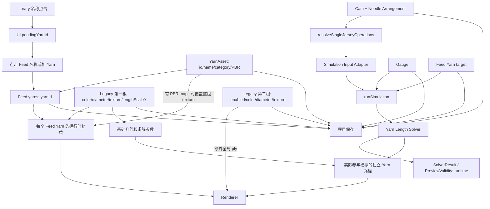

# KnitScape P1 Yarn / Feed 用户工作流审计

日期：2026-10-12（Asia/Shanghai）。结论：**READY_FOR_P1_IMPLEMENTATION**。

本结论表示审计证据足以限定下一阶段任务，不表示当前用户体验无缺陷，也不授权本次进入实现。此次仅新增审计材料，未修改业务代码、项目 Schema 或 P0 baseline，未创建 commit/tag。

## 1. Baseline 确认

| 项目 | 审计前与最终核验 |
|---|---|
| 分支 | main |
| HEAD | 7ababf264d495f6b96d4d66652c529424938ac4d |
| 精确 tag | baseline-trusted-yarn-length |
| tracked 修改 | 0 |
| staged 修改 | 0 |
| 原有文件保护 | 1,035 个文件 SHA-256 全部一致；无删除 |
| 原有未跟踪目录 | ai-manufacturing-strategy-deck/、docs/、reports/，全部保留 |

记录见 [开始核验](C:/Users/liuchen/Desktop/knitscape/reports/p1-yarn-feed-audit-20261012/baseline-confirmation.json)、[最终边界核验](C:/Users/liuchen/Desktop/knitscape/reports/p1-yarn-feed-audit-20261012/final-boundary-check.json)。仓库中旧指导文档仍提及更早基线与“机器参数未持久化”；当前任务明确指定的 7ababf2 已具备该持久化能力。本报告以实际源码和导出文件为准，不恢复旧路线，不改写这些文档。

写入范围：本审计目录内报告、脚本、微型合成贴图、截图和测试项目；用户要求的 build 产生正常 ignored 构建输出；真实浏览器导出还产生 Downloads 中的 pattern*.knitscape，证据副本保存在本目录。未为清理工作区删除任何原文件。

## 2. 当前真实数据关系图



当前机器执行仍由纯 Domain 经 adapter 进入 simulation。Pattern / Repeat 与 Needle Arrangement、Cam 保持独立。本审计没有把业务规则搬入 UI。

关键链路见 [Feed 分配动作](C:/Users/liuchen/Desktop/knitscape/src/actions/yarnLibrary.js:109)、[模拟入口](C:/Users/liuchen/Desktop/knitscape/src/components/runSimulation.js:266)、[材质解析](C:/Users/liuchen/Desktop/knitscape/src/simulation/yarnTextureBrush.js:123)、[最终绘制](C:/Users/liuchen/Desktop/knitscape/src/simulation/drawYarnSimulation.js:43)。

## 3. 权威数据来源矩阵

| 数据 | 当前权威来源 | 第二入口 / 覆盖方式 | 判断 |
|---|---|---|---|
| Yarn 名称 | yarnLibrary[].name | Legacy ply.name 是另一概念 | Asset 名称正确；不代表已定义物理材质 |
| Yarn 分类 | yarnLibrary[].category | 无第二业务入口 | T/CD/N/OP/OTHER，仅分类 |
| Yarn 颜色 | Legacy primary ply.color；PBR 可提供可见纹理颜色 | Asset 当前没有 color 字段；Pattern 色纱另属设计数据 | 有认知冲突 |
| Yarn 直径 | Legacy primary ply.diameter | 第二根有自己的全局直径；Asset 没有 diameter | 所有 assignment 共享主纱直径，不能称每根独立物理纱 |
| PBR | 有 maps 的 Asset.pbr 优先用于该 assignment | Asset 无 maps 时继承 Legacy primary texture，包括旧 PBR/扫描纹理 | 有双来源，但优先级可追踪 |
| physicalRepeatLength | Asset.pbr.physicalRepeatLengthMm；fallback 为 Legacy texture.pbr 对应字段 | 更换 PBR 整组替换该对象，可能清除 repeat | 属材质尺度，不是目标纱长 |
| Feed 使用哪根 Yarn | cam.feeds[].yarns[].yarnId | pendingYarnId 只决定下一次分配动作 | 已分配事实与待分配选择必须区分 |
| Feed Yarn Length | assignment.yarnLengthCmPer100Needles | 单项 / 批量 / explicit clear 共用领域更新链 | P0 权威链成立；求解值不是输入事实 |
| 同 Feed 第 2/3 根 | feeds[].yarns[] 独立元素 | Legacy 第二根是另一个全局附加 ply | 最容易混淆的两个“第二根” |
| Simulation 最终材质 | resolveFeedYarnPlies + active Legacy plies + renderer mode | Auto/WebGL、Canvas fallback、纯色模式行为不同 | “PBR 已设置”不能证明 GPU 已采用全部五图 |

**点击 Library 中一根 Yarn，只选择待分配对象；不会立即改变 simulation。分配后该 Yarn 自己的 PBR 可以生效，但它没有自己的颜色/直径事实。** [Asset 归一化](C:/Users/liuchen/Desktop/knitscape/src/domain/yarnLibrary.js:17) 会保留支持的字段，而不是凭传入对象的任意 color/diameter 建立新权威。调用真实生产函数的 [材质探针](C:/Users/liuchen/Desktop/knitscape/reports/p1-yarn-feed-audit-20261012/material-authority-probe.json) 验证了这一点。

## 4. Legacy 双纱依赖

| Legacy 数据 / 入口 | 分类 | 当前消费者与影响 |
|---|---|---|
| 第一根 color | ACTIVE AUTHORITY | 各 assignment 的纯色/fallback；Asset PBR 覆盖 texture 不覆盖 color |
| 第一根 diameter | ACTIVE AUTHORITY | 基础几何、solver 参数/缓存键、路径宽度；改它会使所有相关目标重新求解 |
| 第一根 lengthScaleY | ACTIVE AUTHORITY | 基础线圈高度；无目标路径仍依赖；有目标时 solver 建立对应路径 |
| 第一根 enabled | LEGACY BUT REQUIRED | 活动 plies 过滤与旧项目兼容；当前首根 UI 无独立开关 |
| 第二根 enabled/color/diameter | ACTIVE AUTHORITY | 全局附加纱，不等于 Feed.yarns[1]；仍可改变最终绘制 |
| 第二根 lengthScaleY、旧 ply 名称 | LEGACY COMPATIBILITY ONLY | 旧数据可保留；当前第二根形状跟随第一根，名称不构成 Asset identity |
| texture、processed scan、旧 PBR、enabled/originalColor/strength/fuzz | LEGACY BUT REQUIRED | 未设置 Asset PBR 的 fallback、旧项目读取、Canvas/WebGL 材质逻辑 |
| 扫描 fileName/sourceType/maxSize/backgroundThreshold 等元信息 | LEGACY COMPATIBILITY ONLY | 序列化/归一化与原有扫描处理兼容；当前常规 UI 不提供完整编辑流程 |
| 未被 panel 调用的旧扫描/PBR 控件函数 | DEAD / UNUSED | yarnScanTextureControls 有定义，但当前 yarnPlyPanel 不调用；不代表底层字段可删除 |
| yarnPalette / yarnSequence | ACTIVE AUTHORITY | Pattern 设计颜色与序列，不应迁成 Feed Assignment |

同 Feed 三个 assignment 加启用 Legacy 第二根，生产绘制函数探针记录 **4 条实际纱线绘制**（含阴影为 8 次 stroke）。这是生产函数在 fixture Canvas 上的计数，不是从截图肉眼数纱，也不是 GPU 验证。浏览器实际建立 A/B/C 三根并启用第二根，UI 同时保留两套入口。

来源：[模拟活动纱与主纱参数](C:/Users/liuchen/Desktop/knitscape/src/simulation/yarnSimulation.js:46)、[路径几何](C:/Users/liuchen/Desktop/knitscape/src/simulation/yarnPathGeometry.js:210)、[Legacy 面板](C:/Users/liuchen/Desktop/knitscape/src/views/yarnPlyPanel.js:386)、[左栏约束 validator](C:/Users/liuchen/Desktop/knitscape/scripts/validate-left-sidebar-modules.mjs:47)。

另确认真实缺陷 **P1-A01 / HIGH：同页面 Load 后 Legacy 第二根复选框可与事实不一致**，详见第 11 节。不能直接删除 Legacy 来规避。

## 5. Yarn 创建流程

从新建后的项目进入“纱线库”，输入 T-001，选 T 分类，点击添加。资产出现在项目列表；编辑名称/分类可保存，ID 和已有 PBR 保持。名称搜索和分类 AND 筛选均实测有效。

点击计数口径：计算页面按钮/分类选择操作，不计算输入文字、测试准备和文件选择器内部点击。创建约 **3 次控件操作 + 名称输入、1 次工作区切换**；分类下拉内部点击因浏览器而异。编辑需展开编辑、输入、保存。

创建后**不自动选中，也不自动成为待分配**。用户需要再点击名称，才出现待分配提示。当前表单只有名称/分类，没有 Asset 自身颜色/直径；对于“我有一根真实纱”的目标，创建完成仅建立身份和贴图容器。空项目仍有默认 Yarn 1；测试删除未引用默认资产后创建 T-001，后来建立 Cam 会按默认 yarnId 补回 placeholder。

隐藏状态：编辑折叠状态、搜索/分类、待分配状态相互独立。用户需记住刚创建名称，并理解下一步要点击名称。**UX friction：MEDIUM**。证据 browser/01–04、12。

## 6. PBR 导入流程

从 T-001 的“编辑”折叠区进入“导入 PBR”，一次文件多选导入 A 组五图。按文件名识别 BaseColor、Normal、Roughness、Height、AO；只识别用户选中的文件，不会由一张 BaseColor 自动扫描磁盘寻找其余图。

约 **2 次页面控件操作 + 1 次文件选择确认**，已处于 Library 时无额外页面切换。导入后展开区有 BaseColor 缩略图、已识别 map 的文件名列表；列表键仍是 baseColor、ambientOcclusion 等内部名。折叠后只显示“PBR 已设置”。没有固定五项完成/缺失清单，也没有每张图的 renderer-ready 状态。缺图允许 fallback，不应把所有缺图一概视为导入失败。

纹理重复长度在同一折叠区，以 mm 输入，change 时提交。A=10 mm、B=12 mm 的真实原生键入与保存包均核验。它不是 cm/100针目标。

实测结果：

| 操作 | 结果 |
|---|---|
| A 五图、B 五图 | 各资产独立，缩略图和文件名正确 |
| 有效 PNG 但名称不能识别 | 明确错误反馈；旧 PBR 保留 |
| 文件名 Normal 但文件内容损坏 | 导入失败反馈；旧 PBR 保留 |
| 清除 PBR | 状态变未设置，缩略图/列表退出 |
| 已有五图与已提交 repeat=10，仅选择 BaseColor 更换 | 整组替换为一图，其他四图及 repeat 被清除 |

最后一项为 **P1-A02 / MEDIUM**：当前动作语义是整组替换，代码可解释，但用户不能从“更换 PBR”明确预知参数也会清除。应先确定产品语义并反馈，不应未经决定改成隐式按图合并。真实对照见 [repeat 对比](C:/Users/liuchen/Desktop/knitscape/reports/p1-yarn-feed-audit-20261012/pbr-repeat-native-comparison.json)。源码为 [importYarnPbr](C:/Users/liuchen/Desktop/knitscape/src/actions/yarnLibrary.js:64)。

**UX friction：HIGH**，主要来自入口发现、缺图反馈、替换范围与物理重复长度的耦合。不是针对视觉样式评分。

## 7. Yarn → Feed 流程

真实路径：Library 点击 T-001 名称 → 出现“待分配 T-001”及操作提示 → 回“三角座 / 排针” → 点击 Feed 1 原 Yarn 名称 → assignment 改为 T-001。

从 Machine 开始约 **4 次控件操作、2 次工作区切换**；已经在 Library 时少一次切换。待分配提示跨工作区可见，名称有 pressed 状态并可取消，不能说当前完全没有选中反馈。

但 Feed 同一名称按钮具有两种行为：无 pending 时打开 Library；有 pending 时立即替换该 assignment。加 Yarn 按钮也依赖 pending。分配完成后 pending 仍保留，方便连续分配多 Feed，但也让下一次点击名称继续具有写操作语义。

分配后 Feed 显示 Yarn 序号、Asset 名称、独立目标纱长和 clear；不显示该 Asset PBR 的完整性、当前材质来源或自己的颜色/直径。用户能回答“Feed 1 是 T-001”，尚不能仅从该行回答“它实际用了哪套材质参数”。四路设置 23 后独立反馈表显示 CONVERGED、已应用、VALIDATED；旧“当前纱长 xx /100线圈”明确标注基础统计，不作为验收值。

**UX friction：MEDIUM**。证据 [四路 23](C:/Users/liuchen/Desktop/knitscape/reports/p1-yarn-feed-audit-20261012/browser/14-four-targets-23.jpg)。按钮条件行为见 [编辑器](C:/Users/liuchen/Desktop/knitscape/src/views/singleJerseyCamProgramEditor.js:213)。

## 8. Multi-Yarn 流程

选择 N-003，再回 Feed 1 点击“+ Yarn”，追加第二根；选择 C-002 再操作一次，追加第三根。每次从 Machine 选新资产约 4 次操作、2 次切换，另输入目标。当前没有两根上限。

| Assignment | 实测目标 | 材质 / 结果 |
|---|---:|---|
| Feed 1 / A=T-001 | 23 | A PBR；约 22.9999，CONVERGED |
| Feed 1 / B=N-003 | 27 | B PBR；约 27.0000，CONVERGED |
| Feed 1 / C=C-002 | 18 | 无 PBR，Legacy primary fallback；约 17.9994，CONVERGED |

B/C 追加不改 A，删除 A 后 B27/C18 保留，替换 A 不改 B/C。每个 assignment 的长度独立；PBR 按所引用 Asset 独立，同一 Asset 被多个 assignment 引用时共享其 PBR，不能称每个 assignment 都复制一套贴图。

数组顺序影响 Yarn 1/2/3 标签与绘制平行偏移；当前没有证据能把这些序号解释为地纱/面纱等完整工艺角色。删除 A 后 B/C 索引前移，P0 revision 保护旧批量选择。tensionCN/placement 字段存在，不等于已实现独立张力或完整添纱工艺模拟。

结论：**同 Feed 多 Yarn 是已进入真实模拟的产品能力，UI 表达和物理属性独立性仍不成熟。** 它不是仅有数组的数据占位，也不能宣称每根材质/几何已完全独立。Legacy“第二支纱线”与 Feed“Yarn 2”同时出现，混淆严重。**UX friction：HIGH**。

## 9. Yarn 更换

实测将 Feed 1 第一根 T-001 换成 N-003：先 Library 选择 N-003，再点击原 assignment 名称。原 target=23 保留；第二根 N-003=27 和 C=18 不变；重新求解成功。由此同一个 Asset 可以在同 Feed 占两个 assignment，各自目标不同。

在被替换的第一根上，A PBR 退出、B PBR 进入；A 仍用于其他 Feed，故不应销毁整个 A 资源。纯色和直径仍由 Legacy primary 提供，不存在“自动换成 N-003 自己直径”这一能力。

目标属于 assignment 的“如何使用这根纱”，当前保留实现一致；但换真实材料后是否继续沿用工艺目标，是用户决策，应明确反馈“保留 23，已重新求解”，不能把几何收敛解释为实机适用。

结构替换通过 setSingleJerseyFeedYarns 发出 replacement intent，state 增加 runtime revision。浏览器看到旧 batch 勾选失效并提示结构变化；旧选择不会误写新 assignment。内部 revision 数值没有通过注入读取，结论由源代码、现有集成 validator 和实际拒绝行为共同支持。

**UX friction：MEDIUM/HIGH**：从 Machine 约 4 次操作、2 次切换；主要问题是替换意图依赖待分配模式。来源 [分配/替换](C:/Users/liuchen/Desktop/knitscape/src/actions/yarnLibrary.js:109)、[revision 单一写入点](C:/Users/liuchen/Desktop/knitscape/src/state.js:177)。证据 browser/18–20。

## 10. 删除流程

| 操作 | 实测行为 | 安全 / 反馈 |
|---|---|---|
| 删除 Feed 1 的 A assignment | 一次移除，B27/C18 保留、序号前移 | 结构 revision 使旧 batch 失效；Asset A 仍在库中 |
| 删除某 Feed 唯一 assignment | 移除按钮 disabled | 当前至少保留一个 Yarn，不能建立完全空 Feed |
| 删除未使用 C-002 | 一次点击删除 | 没有确认/常规撤销恢复；其资源释放 |
| 删除正在使用 T-001 | 阻止，提示“该纱线正在被使用，无法删除。” | 未修改 Feed；未告诉用户具体使用它的 Feed |

保护扫描所有 Feed/所有 Yarn 引用，正常 UI 路径未发现删除在用资产留下悬挂引用。不能由此推断所有手工畸形文件都安全。删除未使用资产后恢复通常需先前保存的项目，现有 Pattern Undo 不提供完整 Yarn Library 事务撤销。

**UX friction：MEDIUM**；“在用阻止”正确，但用户缺少使用位置入口和未用资产删除恢复预期。来源 [deleteYarnAsset](C:/Users/liuchen/Desktop/knitscape/src/actions/yarnLibrary.js:38)、[isYarnReferenced](C:/Users/liuchen/Desktop/knitscape/src/domain/yarnLibrary.js:42)。证据 browser/21–23。

## 11. Save / Reload

通过真实导出按钮保存，不是直接拼接项目文件。配置：G32、4×4 全 K、排针 1234；Feed1=A23+B27，Feed2=A21，Feed3/4=A23；A/B 各五图，repeat=10/12 mm。保存前故意保留 pending B、batch 两项与未提交草稿 24。

“导出 → KnitScape 项目”2 次操作；“导入 → 选择文件”1 次页面操作加文件选择；导入完成回 Pattern，再去 Machine 需一次切换。实测包括同页面打开和完整网页刷新后打开两种情况。

| 核验项 | 结果 |
|---|---|
| Library ID/name/category | 恢复，引用 ID 与保存前一致 |
| Feed 多 Yarn 与目标 | 恢复 [[23,27],[21],[23],[23]] |
| PBR 原图 | 每包 10 图与输入原始字节一致；保存/再次导出共 20 次 SHA-256 比对通过 |
| 物理重复长度 | A10/B12 恢复 |
| 完整刷新后 pending / batch | 无 pending，batch=0 |
| 同页面 Load 的 pending | 清空 |
| 同页面 Load 的 batch | 旧 Map/草稿仍留，勾选已失效；显示旧数量与结构变化提示；点击应用被原子拒绝并清空 |
| 同页面 Library query | 旧搜索保留，可把恢复的资产全部隐藏；清空搜索即出现 |
| revision | Load 发出 replace intent 后重建运行时身份，不读项目 revision |
| SolverResult / PreviewValidity | 重新计算，未保存为项目事实 |
| 保存再导出 manifest | 完全相等；两个真实包均 7,341 bytes |

恢复后的目标反馈：23 → 22.9999；27 → 27.0000；21 → 20.9993；全部 CONVERGED/已应用/VALIDATED。**VALIDATED 仅为模型几何求解成功，未经实机验证。** 主纱直径 .24 时本例模型可解范围约 14.0336–46.7722 cm/100针，不作为实际工艺范围。

实际包核验：[browser-package-check.json](C:/Users/liuchen/Desktop/knitscape/reports/p1-yarn-feed-audit-20261012/browser-package-check.json)。持久化白名单见 [getProjectData](C:/Users/liuchen/Desktop/knitscape/src/actions/exporters.js:135)，加载的 staged registry 与替换见 [loadJSON](C:/Users/liuchen/Desktop/knitscape/src/actions/importers.js:87)。

**P1-A01 / HIGH：Legacy 第二根启用状态显示错误。** 原生点击启用第二根、原生修改主纱直径后，实际下载包证实 secondary.enabled=true、primary.diameter=.29。随后在同页面加载 canonical 保存包，实际再次下载证实值已恢复 false/.24，但屏幕复选框仍勾选，DOM checked=true、checked attribute=null。目标未改变。该问题会让用户错误判断当前是否有全局附加纱。

复现：打开 canonical → 勾选“显示第二支纱线” → 导入 canonical → 观察开关仍勾选 → 导出检查 secondary.enabled=false。完整刷新网页后再 Load，开关正确未勾选；这只是复现条件差异，不是修复。

源码 [yarnPlyPanel.js:416](C:/Users/liuchen/Desktop/knitscape/src/views/yarnPlyPanel.js:416) 用 `?checked` 更新布尔 attribute；用户交互后的 checked property 不保证随该 attribute 改动同步。该解释与 [HTML input checkedness 规范](https://html.spec.whatwg.org/multipage/input.html#dom-input-checked) 一致，也与 P0 批量框采用 `.checked=${live(...)}` 的实现差异一致。没有把未成功读取的 defaultChecked 字段作为证据。三份真实导出与 DOM 对照见 [legacy-checkbox-mismatch-check.json](C:/Users/liuchen/Desktop/knitscape/reports/p1-yarn-feed-audit-20261012/legacy-checkbox-mismatch-check.json)。

另有 **P1-A03 / MEDIUM：项目生命周期反馈不统一**。“新建”实际只新建 Pattern、重置 Legacy 默认值，保留 Library、Cam、Feed target、pending 和 batch。用户若把“新建”理解为新项目，容易以为状态泄漏；改名/说明或改语义应先明确产品契约，不能本次擅自清除数据。

**UX friction：HIGH（同页面恢复反馈）；文件事实恢复本身通过。**

## 12. Yarn Library 的真实产品定位

结论：**Project Yarn Assets**。

| 判断依据 | 当前事实 |
|---|---|
| 随项目保存 | 是，Asset 元数据和原图进入 .knitscape |
| 打开另一完整项目 | 替换项目 Library/registry，不自动 merge |
| 跨项目共享 | 未发现独立共享存储；同页面 New Pattern 保留当前库不等于跨项目库 |
| 独立资产库导入/导出 | 当前主流程没有 |
| merge | 当前完整项目加载没有资产合并策略 |
| 独立 repository | 未发现公司/用户级数据库或服务；localStorage 的语言设置不构成资产仓库 |

可先明确用户文案和项目边界；不能因名称叫 Library 就加入公司级共享、同步、冲突解决等能力。

## 13. PBR 真实数据流

Asset.pbr 的 map assetRef → Feed assignment.yarnId 查找 Asset → resolveFeedYarnPlies 建立运行时材质 → 独立 Yarn 路径 → WebGL 或 Canvas fallback。

1. 任一有效 Asset map 存在时，复制 Legacy primary 的其他属性，整组 texture 改为 Asset PBR；没有按 map 填补 Legacy 缺图。
2. Asset 无 PBR maps 时直接用 Legacy primary。各无 PBR Yarn 因而共用全局颜色、直径、扫描纹理或旧 PBR。
3. Legacy 第二根继续作为额外活动 ply；不会因 Feed 已有 B 就自动退出。
4. yarnLibrary/yarnPlies 变更会停止旧模拟并触发延迟重建；仅切 pending 不会更改模拟材质。
5. WebGL 消费五类贴图；physicalRepeatLengthMm 经针距和路径弧长转为 UV 尺度。Canvas fallback 主要消费 BaseColor/scan，不能当作五图/物理 repeat 效果等价。
6. 纯色模式不显示 Asset PBR 可见色，A/B 都回到共享 Legacy primary color；浏览器已确认。

资源生命周期：每资产导入 token 使后发请求优先，替换/清除/删除释放旧引用；完整项目加载使用独立 staged registry；导出 fork 保留当时原图源；object URL 有 ownership 检查和 revoke。活动材质图片/GPU资源集合按全部参与的 Yarn 保留，不只留第一根。正常 UI 流程未发现 dangling reference。

仍需区分“元数据有图”“图片已解码”“renderer 正在采用”。图片准备使用 Promise.allSettled，加载失败可以降级；当前 Library 的“PBR 已设置”不呈现这种运行时差异。损坏包的延迟读取风险由源码/现有 validator 支持，本次没有把它冒充新增真实浏览器损坏包复现。

Legacy 同时有 scan 与 PBR BaseColor 时，生产函数探针显示 Canvas 优先 scan、WebGL 材质选择优先 PBR BaseColor。旧 useOriginalColor=false 的冷缓存探针还显示 Canvas tinted pattern 已准备时 WebGL raw image 未准备。它们是后续 Legacy 迁移的兼容约束，尚未进行跨 GPU 视觉复现。

来源：[texture 解析与准备](C:/Users/liuchen/Desktop/knitscape/src/simulation/yarnTextureBrush.js:123)、[UV 尺度](C:/Users/liuchen/Desktop/knitscape/src/simulation/yarnPathUvStrip.js:41)、[WebGL 贴图选择](C:/Users/liuchen/Desktop/knitscape/src/simulation/yarnUvWebglRenderer.js:126)、[registry](C:/Users/liuchen/Desktop/knitscape/src/yarnTexture/yarnAssetRegistry.js:21)、[包读写](C:/Users/liuchen/Desktop/knitscape/src/actions/projectPackage.js:66)。

## 14. 用户认知冲突

| 用户疑问 / 冲突 | 实际生效源 | 用户看到的入口 | 严重度 |
|---|---|---|---|
| 选 T-001 后是否已经用了它？ | pending 仅待分配；Feed yarnId 才是事实 | Library pressed/提示 + Feed 按钮 | MEDIUM；提示已存在，动作仍有模式依赖 |
| T-001 的颜色/粗细在哪里？ | 全局主纱 color/diameter | Library 和左侧双纱同时存在 | HIGH；Asset 身份不等于完整物理材料 |
| Feed Yarn 2 是否就是左侧第二支？ | 两个独立来源；后者额外全局 ply | 两套“第二根” | HIGH |
| Load 后第二根勾选，是否真的启用？ | 保存/加载事实 false，DOM 仍 true | 左侧 checkbox | HIGH；已真实复现 P1-A01 |
| 更换一张图为何其他图/repeat 消失？ | whole-PBR replacement | “更换 PBR” | MEDIUM；P1-A02 |
| PBR 已设置是否代表五图都用上？ | map 内容 + 解码 + renderer mode | 粗粒度标签 | MEDIUM |
| 新建为何仍有旧 Feed/Yarn？ | newPattern 只重置设计与 Legacy 部分 | 顶栏“新建” | HIGH；项目边界含混 |
| 导入后库空了？ | 旧 query 隐藏资产 | Library 搜索仍保留 | MEDIUM |
| 明明未勾选，为什么 batch 数量还是 2？ | 旧 selection 失效但 Map/草稿仍在 | 数量 + stale 提示 | MEDIUM；原子拒绝仍正确 |
| 23 与左侧 24.79 哪个是目标结果？ | 目标反馈表为 solver，左侧基础统计 | 已有“非目标求解值”说明 | LOW；本次未当作失败 |
| 改一个 Asset PBR 为什么多个 Feed 都变？ | 共用 Asset 引用 | 缺少使用位置清单 | MEDIUM；共享行为本身合理 |
| 替换材料后原目标为何还在？ | 目标属于 assignment | 名称被替换但数值保留 | MEDIUM；需要清楚反馈保留语义 |

未发现本次证据足以判为 BLOCKER 的 P0 目标写错或失败误标成功。UI 状态错误和模型材质边界仍足以降低生产使用信心。

补充小问题：输入中 Ctrl+A 被全局键盘处理截获，审计时数值输入未按预期全选，改用明确原生编辑完成。来源 [全局快捷键](C:/Users/liuchen/Desktop/knitscape/src/events/keypressEvents.js:3)。归为 LOW 的输入焦点兼容债，不扩展成本次修复。

## 15. KEEP / MIGRATE / DEPRECATE 矩阵与未来领域边界

| 当前功能/字段 | 当前用途 | 用户价值 | 技术依赖 | 推荐 |
|---|---|---|---|---|
| Yarn Library | 项目资产身份与 PBR 容器 | 查找和复用纱 | persistence / Feed references | KEEP |
| pendingYarnId | 下一次分配对象 | 连续分配 | UI/actions，非项目事实 | KEEP_INTERNAL |
| 左侧第一根颜色 | 全局纯色/fallback | 旧流程可用 | 各 assignment 材质 | MIGRATE |
| 左侧第二根颜色/启用 | 全局附加纱 | 旧双纱项目 | active plies / renderer / persistence | MIGRATE |
| global diameter | 路径几何/宽度/solver 参数 | 模型尺度 | 多层计算和缓存键 | MIGRATE |
| scanned yarn texture | 旧扫描/回退材质 | 旧项目保真 | texture normalizer、Canvas/WebGL | MIGRATE |
| 旧扫描/PBR 控件的未调用 UI 函数 | 当前无入口 | 无直接用户价值 | 底层动作仍可能被兼容路径使用 | REMOVE_LATER |
| Yarn Asset PBR | 按 Asset 分配贴图 | 多纱差异 | registry / UV / renderer | KEEP |
| physicalRepeatLengthMm | 纹理物理周期 | 尺度一致性 | PBR 对象 / UV | KEEP |
| Feed Yarn 数组 | 真实 assignment | 一路多纱 | solver / renderer / revision | KEEP |
| Feed Yarn Length | 当前使用目标 | P0 可信求解 | 输入/批量/clear/solver | KEEP |
| feedYarnStructureRevision | 运行时结构身份失效 | 防止批量错写 | state 单一写入点 | KEEP_INTERNAL |
| SolverResult / PreviewValidity | 当前派生结果 | 证明目标是否应用 | 当前机器输入及模拟 | KEEP_INTERNAL |
| 旧 ply 名称及非生效兼容字段 | 旧包兼容 | 可靠打开旧项目 | normalizer / persistence | DEPRECATE |

MIGRATE 是未来分阶段迁移建议，当前所有 Legacy 都保留；REMOVE_LATER 也不授权本次删除。DEPRECATE 字段需先规定读取兼容期，不能立即删保存支持。

未来边界建议：

- **YarnAsset**：id/name/category/PBR 已存在。color/diameter 是实际缺失的独立属性，若加入就涉及迁移、旧默认值、solver 几何和缓存，绝非改名即可完成。physicalRepeatLength 当前在 pbr 内；先处理替换语义，不为理想命名强行搬字段。
- **FeedYarnAssignment**：现有 Feed.yarns 已承担引用、target、tensionCN、placement。可以先在产品语义和模块接口中明确 assignment；没有证据要求立即全仓迁移 assignmentId。保留 P0 的 index + revision 保护。
- **SimulationResult**：solver/applied/reason/validity 继续派生；模型可解范围继续与实机范围分开。
- **UI State**：selected/pending/opened/query/batch draft 继续 runtime-only，项目替换时明确失效/清理策略。
- **Pattern / Repeat、Machine Domain**：继续独立，不能把 Asset 选择或界面生命周期写入纯机器执行规则。

## 16. 真实 Browser 结果

环境：本机生产构建 Vite preview，http://127.0.0.1:5182/，真实 IAB 页面。正常交互经按钮、原生输入、文件选择器完成；未向页面注入 GLOBAL_STATE 或直接调用业务 action。读 DOM 仅用于验证可见控件；下载文件由项目真实导出动作生成。

| 必需用例 | 结果 | 证据编号 |
|---|---|---|
| 1 创建 Yarn | 完成 T-001，非自动待分配 | 01 |
| 2 搜索 Yarn | 名称筛选正确 | 02 |
| 3 分类过滤 | N 类筛选正确 | 03 |
| 4 编辑 Yarn | 名称修改并恢复，资产身份保持 | 04 |
| 5 导入 PBR | 两组五图、错误/清除/替换均验证 | 05–11 |
| 6 分配 Feed | 四路 A、目标 23、VALIDATED | 14 |
| 7 追加第二根 | A23+B27 | 15 |
| 8 追加第三根 | A23+B27+C18 | 16 |
| 9 独立 Yarn Length | 各自收敛、互不改写 | 14–16、20 |
| 10 更换 Yarn | A→B，目标保留，其他 assignment 不变 | 18–20 |
| 11 删除 Assignment | 删除 A，B/C 保留；单根删除禁用 | 21 |
| 12 删除未使用 Yarn | C 删除成功 | 22 |
| 13 删除正在使用 Yarn | A 删除被阻止 | 23 |
| 14 Save | 真实下载包，原图和事实核验 | 24–25 |
| 15 Reload | 同页面 Load 与完整刷新后 Load | 28–33b |
| 16 验证恢复 | 五项目标、A/B PBR、repeat、runtime 重建 | 33b–35、42 |

额外完成：旧 batch 拒绝、保留 query、New Pattern 边界、纯色 fallback、Legacy 全局影响、Legacy checkbox 事实/显示不一致。**16 项已执行，不表示每个工作流体验均通过。**

证据索引 [browser/results.json](C:/Users/liuchen/Desktop/knitscape/reports/p1-yarn-feed-audit-20261012/browser/results.json)，每项有 DOM 文本和截图。截图文件名中的序号对应本表。


证据限制与排除：

- 初始 IAB 窄视口 548×669 导致部分控件不可正常操作，后用 1440×1000 桌面视口完成流程；此次不是移动端适配验收。
- 初次自动 fill 的 repeat 值仅在 DOM 中变化，未真正触发提交；这些中间包不作为产品缺陷证据。之后用原生键入/失焦并检查真实导出包，才确认 whole-PBR replacement 清除 repeat。
- 初次 offscreen Feed 点击、错误 locator、异步 Load 尚未完成时的中间截图不算成功证明；成功证据采用 14、33b、42。
- A/B 是两组小型合成图，便于证明独立绑定和原图字节保存，不代表真实纱线物理校准；没有 GPU 型号矩阵或五种 map 各自效果量化。
- material-authority-probe 调用实际生产导出函数，但 Canvas/Image 为 fixture，不冒充全 runSimulation 浏览器或真实 WebGL shader 测试。
- 最终页面采集的 error/warn 日志为空；不据此宣称整段审计从未出现预期错误或导入错误。

## 17. 用户路径评分

评分遵循 5=能完成但明显难用、7=基本自然偶尔需学习、9=无需解释。评分为本次审计判断，不是用户样本统计。

| 项目 | 分数 /10 | 主要依据 |
|---|---:|---|
| Yarn 创建 | 6 | 入口可用、创建简单，但物理属性不完整且下一步非自动 |
| PBR 导入 | 5 | 折叠入口、粗粒度状态、整组替换/repeat 语义不明确 |
| Yarn 选择状态 | 7 | 名称 pressed 和跨页待分配提示有效 |
| Feed 分配 | 6 | 可完成，但按钮行为依赖 pending |
| Feed 当前 Yarn 可理解性 | 6 | 名称/target 清楚，实际材质来源不清楚 |
| 同 Feed 多 Yarn | 5 | 真能力且长度隔离；全局 Legacy 第二根造成混淆 |
| Yarn 更换 | 5 | 需往返、替换意图隐含、保留 target 需解释 |
| Yarn 删除安全 | 6 | 在用保护正确；缺引用位置、未用删除无常规恢复 |
| Project 保存恢复 | 6 | 文件事实/原图可靠；同页 checkbox/query/batch 反馈有问题 |
| 总体第一次使用体验 | 5 | 要理解两套材质权威与三种选择/应用状态才能放心使用 |

## 18. npm run validate

**PASS，36/36，exit 0。** 本次实际运行，完整输出见 [validate.log](C:/Users/liuchen/Desktop/knitscape/reports/p1-yarn-feed-audit-20261012/validate.log)。

包括 P0 result/failure/input/batch/structure integration，no-yarn-length、machine/arrangement/execution，Yarn Library、PBR persistence、Feed PBR、multi-Yarn、cache lifecycle、simulation characterization 等相关 validators。

补充审计脚本也通过：

| 脚本 | 验证内容 |
|---|---|
| material-authority-probe.mjs | 真实函数的材质来源、3+1 纱数量、旧 Canvas/WebGL 选择差异 |
| inspect-browser-packages.mjs | 实际浏览器包、20 次图片字节比对、目标/引用/manifest 相等、runtime 字段排除 |
| inspect-legacy-checkbox.mjs | 实际三份包与 DOM 构成 Legacy 显示缺陷证据 |
| verify-audit-boundary.ps1 | baseline、tracked/staged、1,035 文件保护和 diff check |

这些脚本只在审计目录，未注册进 package.json，未修改正式测试或业务实现。脚本 PASS 是“证据断言成立”，Legacy 缺陷脚本通过不表示缺陷已修复。

## 19. npm run build

**PASS，exit 0。** Vite 4.4.7，746 modules transformed，5.52s。日志 [build.log](C:/Users/liuchen/Desktop/knitscape/reports/p1-yarn-feed-audit-20261012/build.log)。npm 输出升级通知，不构成构建失败；没有升级依赖。真实浏览器验收消费该生产构建。

## 20. git diff --check 与保护结果

**PASS，exit 0；git diff --stat 为空。** staged 与 tracked 均无变化；HEAD/tag/main 保持。审计前 1,035 个受保护文件哈希一致。

最终 `git status --short`：

```text
?? ai-manufacturing-strategy-deck/
?? docs/
?? reports/
```

前两目录及 reports 原有文件均保留；本任务新增内容集中于 reports/p1-yarn-feed-audit-20261012。没有使用 add、commit、tag 创建、push、reset、checkout、stash 或 clean。没有项目 Schema 修改；SolverResult / PreviewValidity / feedYarnStructureRevision 仍不持久化。

## 21. 最大用户问题 Top 3

1. **用户无法只凭 Yarn 名称和左侧状态确定真实材料。** Asset PBR 与 Legacy 颜色/直径、附加第二根并存；同页 Load 又存在开关显示与事实不一致，直接影响信任。
2. **PBR 的“导入完成、替换范围、实际生效”混在一起。** 五图与单图都显示已设置；更换会清 repeat；Feed 不显示材质来源/降级。
3. **项目边界与 UI 生命周期不一致。** New 保留机器/资产但重置 Legacy；Load 清 pending，却保留搜索和失效 batch 草稿，用户可能误以为资产丢失或旧选择仍有效。

## 22. 最大架构问题 Top 3

1. **材料权威分裂。** Asset 是 identity+PBR，几何/颜色仍在全局 primary；独立 Feed Yarn 长度已具备，但独立物理纱线模型尚不完整。
2. **PBR 对象同时承担资源集合与物理尺度，运行时就绪状态缺少统一表达。** 整组替换顺带清 repeat；renderer fallback 与 metadata 状态不能互相替代；Legacy Canvas/WebGL 还有兼容差异。
3. **项目事实替换与 UI 控件状态同步分散。** revision 正确保护原子提交，但 query、batch、Legacy checkbox 的可见状态生命周期不同，导致“事实安全、反馈不可信”。

## 23. 第二阶段真正应优先解决的 3 件事

1. **先修用户可见状态与实际事实一致性。** 最小范围处理 Legacy checkbox 的 Load 同步；定义并验证 New/Open 后 query/pending/batch 的清理或明确保留语义。保持 P0 原子拒绝能力。
2. **把选纱、分配、替换、材质反馈讲清楚。** 用明确动作和最少必要反馈让用户知道 Feed 当前是谁、哪些 Feed 在用、PBR 是否完整/采用、目标保留还是清除。先确定 PBR whole-set replacement 与 repeat 的产品契约，再实现最小修改。
3. **随后进行有兼容约束的材质权威迁移。** 明确 Asset color/diameter 与 Legacy fallback 的迁移策略；覆盖旧项目、无目标模拟、多 Yarn、solver 缓存与 Canvas/WebGL，保持纯 Machine Domain。不能先删 Legacy 或只加输入框。

## 24. 现在不应做的内容

不做视觉重构、GLOBAL_STATE 重写、Command Bus、Event Sourcing、全仓 assignmentId 迁移、公司共享 Yarn 库、同步/merge 服务、Legacy 删除、PBR 新渲染功能、GSM/幅宽/耗纱等生产计算。Undo 是已识别的后续生命周期能力，不应与本次第一批修正一起重做。

不重新打开已冻结的 P0 纱长语义，不为报告发现的 UX 问题改写 target，不把 VALIDATED 扩大成实机验证，不把模型范围称为工艺范围。不以清理工作区为由提交/删除历史材料。

## 25. 推荐实施顺序

| 顺序 | 限定交付 | 完成判据 |
|---|---|---|
| P1 第 1 个小任务 | 状态事实一致性与项目动作语义 | 原生点击后 Load 的 checkbox 与导出事实一致；New/Open 的 UI 状态契约明确；P0 旧选择仍原子拒绝 |
| P1 第 2 个小任务 | Yarn→Feed 动作及 PBR 反馈闭环 | 首次用户可识别选中、分配、替换、当前引用、使用位置；替换 PBR 的 maps/repeat 变化可预知 |
| P1 第 3 个小任务 | Asset 材料属性与 Legacy 兼容迁移设计后实施 | 每个属性有唯一权威/明确 fallback，旧包可打开，几何/solver/缓存/renderer 一致，不复制机器执行逻辑 |
| 更后续独立任务 | 完整项目生命周期、Undo、可选共享库 | 单独定义数据边界和恢复策略；不混入前述小任务 |

每一步保留 main/P0 baseline 作为对照，新增围绕真实用户结果的回归；不得一次性打包成大 UI/状态框架改造。

## 26. 是否建议马上开始代码修改

**READY_FOR_P1_IMPLEMENTATION**。

审计已覆盖要求的 16 项真实浏览器流程、实际项目原图与事实恢复、材料权威和 Legacy 依赖，并给出可复现问题。建议下一条明确任务先授权第 25 节第一个小任务；无需再重复整轮泛化审计。

本轮完成后停止。未修复上述缺陷，未开始第二阶段实现，未修改业务代码/Schema，未 commit/tag。主要遗留风险：Legacy 材料权威、真实同页 checkbox 缺陷、PBR 就绪/降级反馈、New/Open UI 生命周期，以及尚未覆盖的真实材料与跨 GPU 表现。
